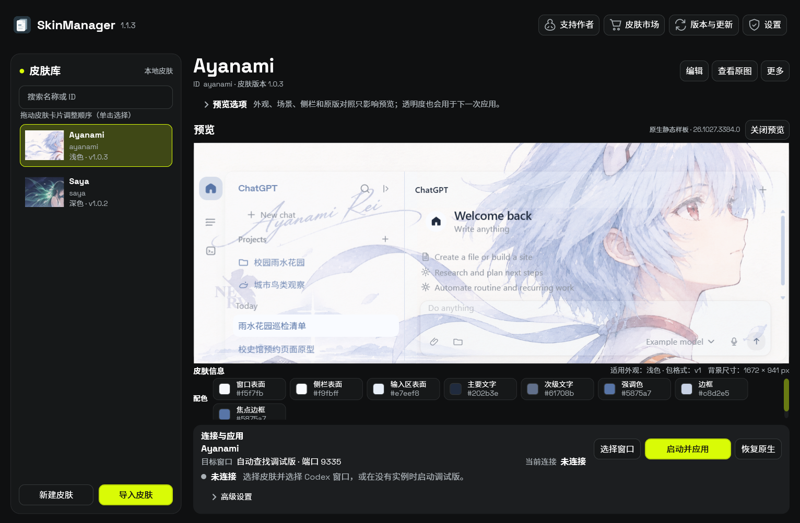
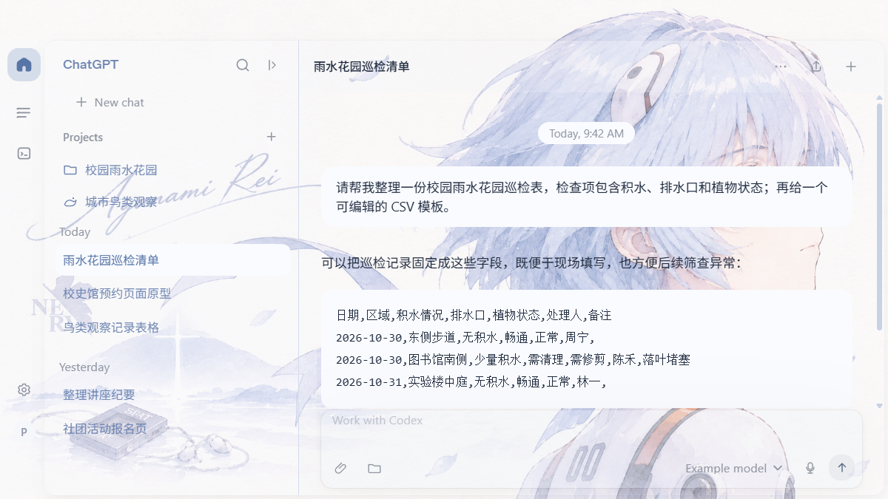
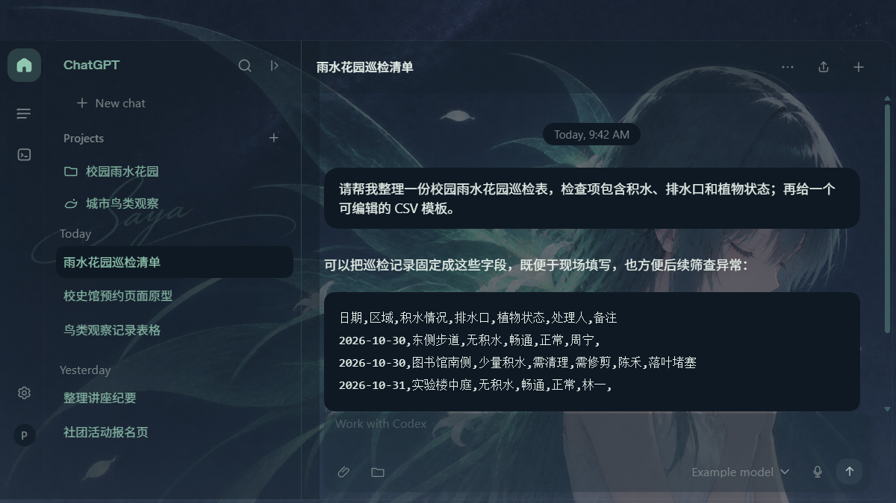
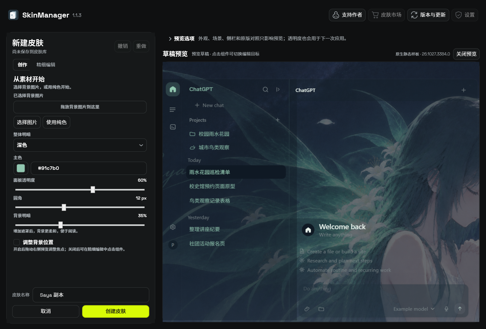
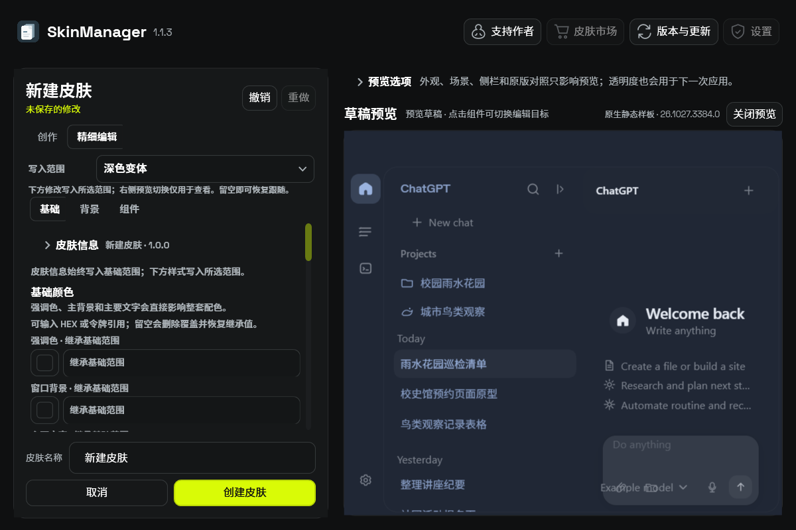
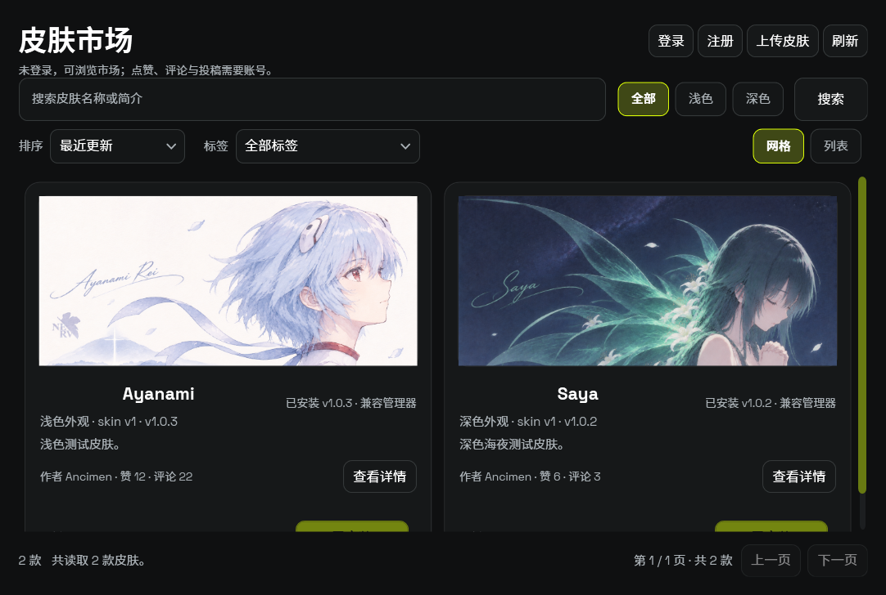

<p align="center">
  
</p>

<h1 align="center">SkinManager</h1>

<p align="center">为 Windows 上的 Codex 桌面版制作、预览和管理皮肤。</p>

<p align="center">
  <a href="https://github.com/Nortea575/SkinManager/releases/latest">下载最新版</a> ·
  <a href="#快速开始">快速开始</a> ·
  <a href="https://blog.ancimen.top/?page_id=39">皮肤市场</a> ·
  <a href="CHANGELOG.md">更新日志</a>
</p>

SkinManager 让你为 Codex 桌面版更换背景、颜色与透明度，并在应用前预览效果。你可以从皮肤市场下载现成主题，也可以从一张图片或纯色背景开始，制作自己的皮肤。

## 效果展示



在同一个窗口中管理皮肤、查看预览并选择应用目标。预览区会随窗口尺寸调整。

<details>
<summary>查看浅色与深色皮肤示例</summary>

| Ayanami · 浅色 | Saya · 深色 |
| --- | --- |
|  |  |
| 蓝白配色，默认面板透明度 75% | 墨蓝与浅绿配色，默认面板透明度 60% |

</details>

## 主要功能

- **皮肤管理**：搜索皮肤，直接拖动卡片调整顺序，导入文件夹或 ZIP，导出备份并删除不再使用的皮肤。
- **快速创作**：从图片、纯色或已有皮肤开始，调整整体配色、透明度、圆角与背景位置。
- **精细编辑**：编辑组件及交互状态、浅深色变体和首页／对话场景，支持撤销与重做。
- **效果预览**：切换首页与对话场景、浅深色外观和侧栏，对照原生界面查看变化。
- **透明度调整**：直接输入 0–100 的数值，也可跟随皮肤默认设置。
- **皮肤市场**：搜索、筛选和排序皮肤，下载安装；登录网站账号后，可在软件内投稿、点赞和评论。
- **连接与恢复**：启动调试版并等待连接就绪后自动应用；已有唯一可用调试实例时自动连接，多个实例可手动选择。普通 Codex 仍运行时可确认切换到调试模式。
- **设置页面**：切换管理器的白昼／夜间外观，管理简体中文与 Magpie 兼容选项。
- **软件更新**：自动检查和下载新版本，提示后由你点击安装；支持可选测试通道和离线历史更新日志。

### 可视化制作器

“创作”页把选图、整体明暗、主色和面板设置集中在一起。启用“调整背景位置”后，可直接拖动右侧预览安排构图；名称与创建按钮固定在编辑区底部。



<details>
<summary>查看精细编辑</summary>

切换到“精细编辑”，可继续调整基础颜色、背景参数、组件属性及交互状态。选择写入范围后，可以为浅色、深色、首页或对话单独设置样式；清空字段可恢复继承。



</details>

### 皮肤市场

按最近更新或最多点赞排序，也可搜索名称、说明并筛选外观及标签。标签筛选在市场提供标签时显示。点击卡片进入详情，查看作者、完整介绍、版权与兼容要求；点击“下载并安装”后保存到皮肤库，再选择应用。

市场中的图片用于展示封面，安装后可在本地皮肤库查看效果预览。

点击“登录”或“注册”，在软件内使用皮肤市场网站的账号。注册与找回密码沿用网站流程。登录后可在详情页点赞和发表评论；点击“上传皮肤”，可选择皮肤库中的作品或本地 ZIP，填写说明与授权信息后提交。普通账号的投稿和评论会按市场规则进入审核，软件会显示实际提交结果。



皮肤通过市场独立下载，安装包不内置皮肤。

## 快速开始

### 运行要求

- Windows x64。
- 通过 Microsoft Store 安装的 Codex 桌面版。
- Microsoft Edge WebView2 Runtime，用于界面预览与市场账号登录。

安装包已包含所需的 .NET 运行时，无需另装 .NET SDK。

当前安装包未进行代码签名。

### 安装与应用皮肤

1. 从 [GitHub Releases](https://github.com/Nortea575/SkinManager/releases/latest) 下载最新版安装包并安装。
2. 打开“皮肤市场”下载皮肤，或通过“导入皮肤”导入已有文件夹或 ZIP。
3. 选择要使用的皮肤，点击“启动并应用”。管理器会等待调试连接就绪并应用所选皮肤；如果检测到已运行的普通版 Codex，可按提示确认退出该实例并切换到调试模式。
4. 需要恢复原生外观时，点击“恢复原生”。

如果已有开启调试连接的 Codex，可通过“选择窗口”指定对应目标，也可在其中定位或退出实例。默认调试端口为 `9335`。

### 制作自己的皮肤

1. 点击“新建皮肤”，选择或拖入背景图片，也可以直接使用纯色背景。
2. 选择浅色或深色，调整主色、面板透明度和圆角，右侧会显示草稿效果。
3. 使用图片时，可调整“背景明暗”；勾选“调整背景位置”后，拖动右侧预览安排画面，完成后关闭该选项。
4. 在底部填写名称，点击“创建皮肤”保存到皮肤库。

想从已有作品开始，可在皮肤库选中皮肤，通过“更多 → 以此为基础创建”制作独立副本。副本保留来源皮肤的作者、图片和样式，保存时使用独立 ID。

作者与皮肤版本可在“精细编辑 → 基础 → 皮肤信息”中补充。编辑某种外观或页面的专属样式前，先在“精细编辑”中选择对应的“写入范围”；右侧预览选项只切换查看效果，不会改变写入范围。

完成保存后，在皮肤库选中作品，通过“更多 → 导出皮肤…”导出 ZIP，用于备份或分享。

### 固定使用简体中文

在“设置”的兼容选项中启用“固定使用简体中文”，通过已验证的调试连接设置 Codex 的原生界面语言。该选项独立于皮肤，切换皮肤或重新打开管理器后仍会保留。

未连接时会保存选择并显示待生效状态；首次设置可能刷新 Codex 页面。关闭此选项时，仅在语言仍由管理器控制的情况下恢复原来的选择，保留你后来手动更改的语言设置。启动时的语言切换速度仍取决于 Codex 自身的初始化过程。

### Magpie

在“设置”的兼容选项中查看 Magpie 的安装、版本和运行状态。SkinManager 从自身启动调试版 Codex 时，可以正常使用 Magpie 网关模型。

Magpie 修改 `~/.codex/config.toml` 中的模型配置后启动普通 Codex。完成模型设置后，可在 SkinManager 点击“启动并应用”；如果普通 Codex 仍在运行，确认切换后由管理器正常退出该实例，再以调试参数启动、连接并应用皮肤。Magpie 自身继续运行，Codex 沿用已有模型配置。

设置页分别显示 Magpie 的运行信息和 Codex 配置文件是否可读取；配置文件可读取不代表已验证模型或网关连接。切换遇到退出未完成或进程身份变化时，可通过“选择窗口”检查后重试。

## 使用说明

### 皮肤保存与备份

皮肤保存在程序同路径的 `skin` 文件夹中，每款皮肤使用独立目录，包含 `skin.json` 和背景图片等资源。导入会复制完整皮肤包，导入后不依赖原文件所在位置；导出 ZIP 可用于备份和分享。

升级安装会保留皮肤库，卸载时可选择保留或删除。

直接拖动皮肤卡片调整顺序，重启后仍会保留。新导入或创建的皮肤追加到末尾，排序不会改写皮肤包。搜索期间暂停排序，清空搜索后即可继续调整。

### 管理器外观

在“设置”中选择夜间或白昼模式，即时切换并在重启后保留。此选项控制管理器窗口、菜单和提示，皮肤内容及预览外观继续按作品和预览选项显示。

### 透明度与预览

面板透明度可输入 `0–100`：`0` 为不透明，`100` 为完全透明。启用“跟随主题”时使用皮肤的默认值。

编辑皮肤时，预览使用草稿自身的默认透明度，管理页的手动应用透明度暂时停用；退出编辑后恢复原来的应用设置。要把透明度保存到皮肤中，请在“创作”页或“精细编辑”中修改。

“背景明暗”调整图片遮罩，与面板透明度分别控制。管理页的手动应用透明度只影响预览与下一次应用，不会改写皮肤包。

预览使用静态示例界面与示例内容。实际效果可能随 Codex 版本和页面结构变化；发现异常时，请在反馈中注明所用版本和皮肤。无需预览时，可点击“关闭预览”释放资源并收起区域，再次打开会恢复当前皮肤或编辑草稿。

### 连接与更新

关闭 Codex 窗口后，程序可能仍驻留托盘。可通过“选择窗口”检查运行状态，或按主操作提示确认切换为调试版。只有确认目标是可连接的调试版 Codex 后，管理器才会发送皮肤脚本。

从托盘退出 Codex 后，管理器会自动更新连接状态。已有调试版会按实际监听的本机地址连接，支持 IPv4 与 IPv6；窗口列表中的调试版标记表示带有调试启动参数，连接状态会另行显示是否可用及不可连接的原因。活动会话会核验原有进程身份和监听归属，短暂探测无响应时继续保留已有连接。

皮肤与语言兼容共用同一个后台连接，关闭管理器后可继续运行。点击“恢复原生”会移除皮肤；如果仍开启“固定使用简体中文”，语言兼容连接会保留。需要关闭固定语言时，请在“设置”中关闭对应开关。

在“版本与更新”中查看更新状态。下载完成不会立即安装，点击“安装更新”后才会开始；安装后需重新应用皮肤。

切换到“历史日志”可查看随当前版本附带的更新记录，无需联网。

“接收测试版更新”默认关闭。开启后会同时检查 GitHub 上版本高于当前版本的测试版与正式版，并在更新窗口标明测试版。开关会在重启后保留；关闭后恢复仅检查正式版，不会自动降级已安装的测试版。

## 从源代码构建

在 Windows 安装 .NET 9 SDK 后，从仓库根目录运行：

```powershell
dotnet restore .\SkinManager.sln
dotnet build .\SkinManager.sln -c Release --no-restore
```

<details>
<summary>构建安装包</summary>

还需安装 Inno Setup 6.7.4，并将 `ISCC.exe` 所在目录加入 `PATH`。在仓库根目录执行：

```powershell
dotnet publish .\src\SkinManager.Desktop\SkinManager.Desktop.csproj -c Release -r win-x64 --self-contained true -p:PublishSingleFile=true -p:IncludeNativeLibrariesForSelfExtract=true -o .\artifacts\publish\desktop
dotnet publish .\src\SkinManager.Agent\SkinManager.Agent.csproj -c Release -r win-x64 --self-contained true -p:PublishSingleFile=true -p:IncludeNativeLibrariesForSelfExtract=true -o .\artifacts\publish\agent
.\build\Build-Installer.ps1
```

安装包输出到 `artifacts/release`。如果编译器未加入 `PATH`，可为 [build/Build-Installer.ps1](build/Build-Installer.ps1) 传入 `-CompilerPath` 参数指定 `ISCC.exe`。

</details>

## 反馈与贡献

欢迎通过 [Issues](https://github.com/Nortea575/SkinManager/issues) 反馈问题和提出建议，或通过 **Pull Request** 贡献改进。

反馈问题时，请提供 SkinManager 版本、Codex 版本、皮肤名称、复现步骤和相关截图，便于定位。

## 作者与版权

作者：**Ancimen**。

SkinManager 免费分发。支持项目开发可访问[赞助页](https://blog.ancimen.top/?page_id=170)，或点击软件内的“支持作者”。

官方皮肤由 Ancimen 发布，**保留所有权利**。第三方皮肤及素材遵循各自的授权声明。

管理器使用 [Space Grotesk](https://github.com/floriankarsten/space-grotesk) 显示英文与数字，使用 [Noto Sans SC](https://github.com/notofonts/noto-cjk) 显示中文；两者均采用 SIL Open Font License 1.1。授权全文见 [ThirdPartyNotices.txt](src/SkinManager.Desktop/ThirdPartyNotices.txt)，安装目录中也附有同名文件。

SkinManager 是独立项目，并非 OpenAI 官方产品。预览界面使用的 Codex CSS 与字体归各自权利方所有；安装器简体中文翻译来自 [Inno Setup Chinese Simplified Translation](https://github.com/kira-96/Inno-Setup-Chinese-Simplified-Translation)。
